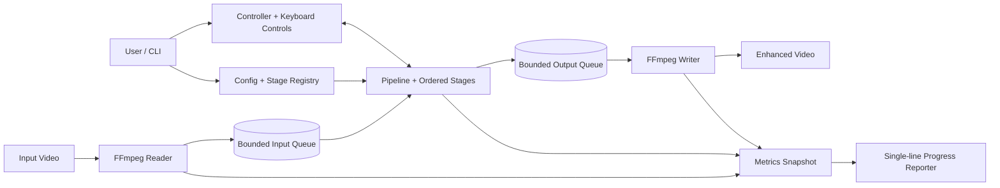
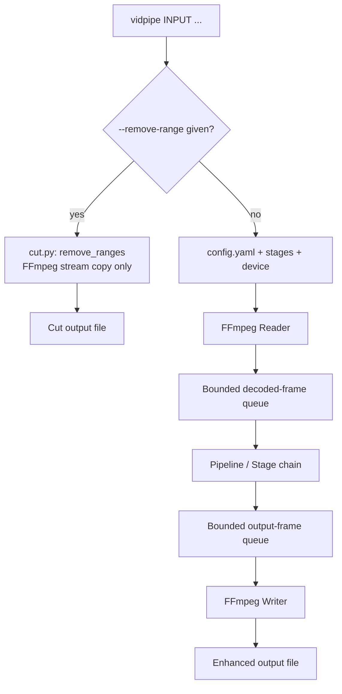
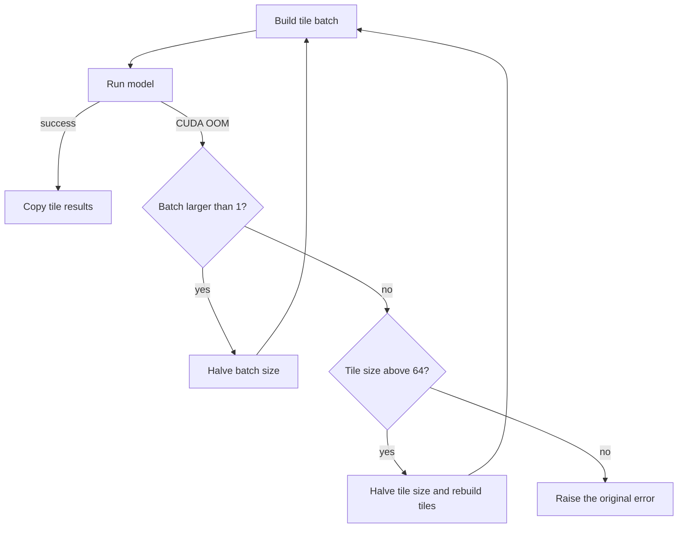
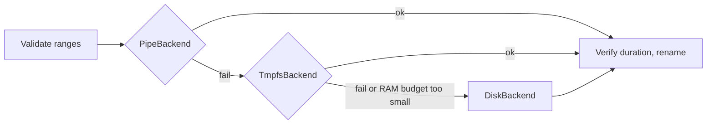
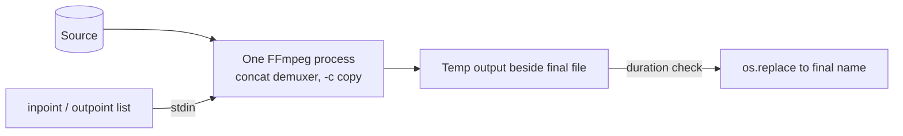
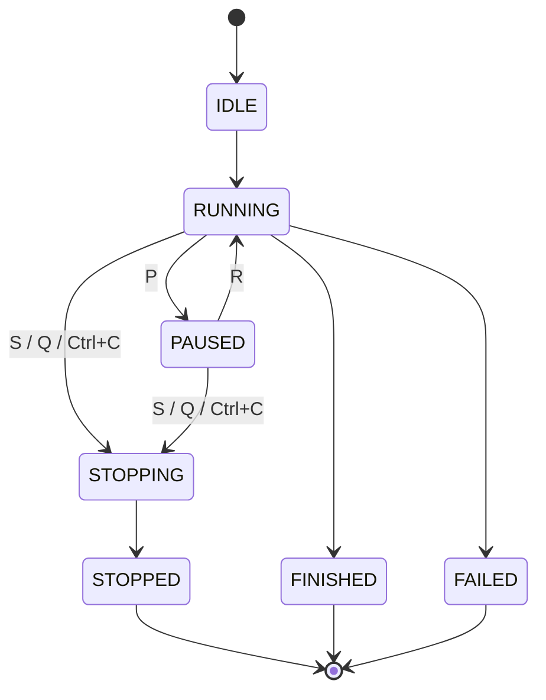

# vidpipe architecture

## 1. Purpose and scope

vidpipe has two independent jobs that share one CLI:

1. **Enhancement.** It decodes a video into RGB24 frames, runs them through an ordered chain of image-model stages, and encodes the result. Frames move through bounded in-memory queues; no intermediate image is written per frame.
2. **Lossless time-range removal.** `--remove-range` cuts one or more time ranges out of a video with FFmpeg stream copy (`-c copy`). Nothing is re-encoded and no model is loaded.

This release improves the existing PyTorch pipeline. It does **not** add ONNX, TensorRT, RIFE, multi-GPU execution or concurrent model-inference workers.

## 2. Directory structure

```
vidpipe/
├── README.md                    # Installation, commands, configuration and usage (English)
├── README_FA.md                 # Persian user guide
├── ARCHITECTURE.md              # This document: modules, data flow and design limits
├── ARCHITECTURE_FA.md           # Persian translation of this document
├── config.yaml                  # Default FFmpeg, device, memory and stage settings
├── requirements.txt             # Python runtime and test requirements
├── .gitignore                   # Ignore models, media, outputs, caches and environments
├── bin/
│   └── vidpipe                  # Executable CLI launcher; avoids `python -m` at the prompt
├── scripts/
│   └── install-cli.sh           # Creates ~/.local/bin/vidpipe as a symlink to bin/vidpipe
├── models/                      # User-provided model weights; not committed to Git
├── output/                      # Default generated video output directory
├── vidpipe/
│   ├── __init__.py              # Package version
│   ├── main.py                  # Argument parsing; dispatches to cut mode or enhancement mode
│   ├── cut.py                   # Lossless range removal with pipe, tmpfs and disk backends
│   ├── config.py                # YAML defaults and validation of user settings
│   ├── controller.py            # Run-state transitions: pause, resume, stop and failure
│   ├── pipeline.py              # Reader/inference/writer threads, queues and timing counters
│   ├── video_io.py              # FFprobe metadata, FFmpeg frame decoding and video encoding
│   ├── memory.py                # Device selection, RAM queue sizing and PyTorch VRAM telemetry
│   ├── naming.py                # Model-chain, scale and denoise output-name generation
│   ├── progress.py              # Single-line, color-aware progress display and ETA
│   ├── controls.py              # Immediate P/R/S/Q keyboard controls; restores terminal mode
│   ├── registry.py              # Mapping from YAML stage names to stage classes
│   └── stages/
│       ├── __init__.py          # Stage package marker
│       ├── base.py              # Frame, FrameSpec and Stage interface
│       ├── identity.py          # Pass-through stage used by tests
│       └── model.py             # Spandrel model loading, tile batching and CUDA OOM recovery
└── tests/
    ├── test_config.py           # YAML validation tests
    ├── test_controller.py       # Controller state validation tests
    ├── test_controls.py         # Single-key input without Enter (PTY test, POSIX only)
    ├── test_cut.py              # Range removal: each backend, fallback and cleanup
    ├── test_memory.py           # Queue-depth and device/memory planning tests
    ├── test_model.py            # Tile batching and simulated CUDA OOM recovery
    ├── test_naming.py           # Output filename and collision behavior
    ├── test_pipeline.py         # Reader-to-writer pipeline and counters
    ├── test_progress.py         # Progress formatting and ETA helper tests
    └── test_video_io.py         # FFprobe frame-rate and frame-count estimation tests
```

## 3. Conceptual architecture

The enhancement path has three cooperating work areas: media I/O, ordered frame inference, and user control/telemetry. Bounded queues decouple the speeds of the reader, model and writer, so memory use does not grow with video duration.



## 4. High-level data flow

`main.py` chooses one of two paths before anything else is loaded:



The reader thread can decode upcoming frames while the pipeline thread processes the current frame. The writer thread can encode completed frames while the next frame is being enhanced. The queues are bounded, so memory use is not proportional to the full video duration.

## 5. Threads and queues

| Worker   | Responsibility                                  | Main wait point                      |
|----------|-------------------------------------------------|--------------------------------------|
| Reader   | Read fixed-size RGB24 frames from FFmpeg stdout | Input decoder / decoded-frame queue  |
| Pipeline | Execute each configured stage in order          | Model inference / output-frame queue |
| Writer   | Send output frames to FFmpeg stdin              | Encoder and disk I/O                 |

`queue_depth` is the maximum number of items in each queue. In automatic mode, `memory.py` estimates a RAM-safe depth from free RAM and decoded/output frame sizes. The actual depth is `min(config.queue_depth, memory_plan.depth)`. In manual mode, `memory.prefetch_depth` is used before applying the configured hard cap; a non-zero `memory.max_ram_gb` adds a second cap based on the combined input/output frame memory. The automatic estimate never forces more than one frame into each queue when RAM is tight.

The queue threads overlap CPU-side decode and encode with inference. They do not make the model stage multi-threaded, and they do not run multiple model calls concurrently on the GPU.

Cut mode does not use these threads. It runs FFmpeg subprocesses one after another (see section 11).

## 6. Model execution, tile batching and OOM recovery

`ModelStage` loads each model once through Spandrel. It converts a frame to a `(1, 3, H, W)` tensor, pads the full frame so tiles can see real neighboring pixels, and then groups tiles by their crop dimensions.

Tiles with equal dimensions are combined along the batch dimension and sent to the model in one call. Border tiles can be narrower or shorter, so a different shape is processed in a separate batch. Each tile's center region is copied back into its correct output coordinates; padding pixels are never written into the final frame.

The optional PyTorch VRAM allocator cap is applied before model weights are loaded. It limits allocations made through PyTorch's CUDA caching allocator. It is not a hardware-wide reservation and does not constrain unrelated GPU processes.

The configured `batch_size` is the initial number of tiles per inference call. The actual batch may be smaller when fewer tiles remain in a group.

### CUDA out-of-memory recovery



The current frame is retried from the beginning after a failed attempt, so partially written tile results are never mixed into the final frame. The reduced batch and tile values are kept for later frames in the same run. Recovery is best-effort: if the model weights or one minimum-size tile cannot fit in VRAM, the run still cannot proceed.

## 7. CPU/GPU transfers and synchronization

Each input frame is converted to a tensor and moved to the selected device. Tiled inference stays on that device. At the end of a frame, the completed output is converted to uint8 and copied back to CPU memory once, so it can be passed to FFmpeg.

There is no explicit `torch.cuda.synchronize()` in the tile loop. PyTorch queues CUDA work asynchronously; converting the final result to a CPU byte buffer is the synchronization point for the completed frame. This avoids a full synchronization after every tile. It does not remove the one device-to-host copy per frame required by the FFmpeg pipe interface.

## 8. Keyboard input and terminal behaviour

The old line-oriented input (`for line in sys.stdin`) required Enter after each control letter. `controls.py` now reads one character at a time in terminal cbreak mode. On POSIX it opens `/dev/tty` when stdin is redirected. On Windows it uses `msvcrt`. The original terminal settings are restored when the listener exits.

- `P`: pause. `R`: resume. `S` or `Q`: request a clean stop. `Ctrl+C`: converted into the same clean-stop request by a signal handler on the main thread.
- If no controlling terminal is available, single-key control is disabled and the run continues.

## 9. Progress and performance metrics

`pipeline.py` keeps thread-safe counters (frames read and written, time in the reader, stage chain and writer, queue occupancy). `main.py` takes a snapshot at every refresh and passes it, with the run state and GPU telemetry, to `ProgressReporter`.

Before processing starts, `ProgressReporter.print_header` prints the static run information once: input, output, resolution, frame count, models, device, precision, codec and queue depth.

The live output is a **fixed six-line panel**:

1. Status, progress bar, exact done percentage and exact left percentage.
2. Frames processed / total, and remaining frames.
3. Smoothed FPS, wall-clock elapsed time and ETA.
4. Model name, tile progress (tile size and batch) and input/output queue occupancy.
5. VRAM usage (PyTorch), GPU utilization (NVML), and OOM retry count when non-zero.
6. Average decode, process and encode milliseconds per frame.

Design rules:

- **One source of truth for percentages.** Done and left percentages both come from `processed / total`, so they always sum to 100.
- **Fixed positions.** Each field has a fixed label and value width. Padding is applied before ANSI colors, so columns stay aligned.
- **In-place redraw on a TTY.** `print_update` moves the cursor up by the number of lines drawn last time (`ESC[nA`) and rewrites each line after clearing it (`ESC[2K`). Redirected output gets one record per refresh.
- **Honest estimates.** When the frame count is estimated (variable frame rate), values are marked with `~` and `(approx.)`. ETA is based on smoothed throughput and is not a guarantee.
- **No forced synchronization.** The reporter reads counters and telemetry only.

GPU telemetry has two sources. VRAM (allocated, reserved, free) comes from PyTorch. GPU utilization comes from NVML through the optional `pynvml` package, read by `memory.gpu_memory_stats`. If `pynvml` is missing or fails, the field shows `n/a`. The NVML device index is fixed at 0 and does not follow `CUDA_VISIBLE_DEVICES`.

## 10. Output naming and FFmpeg options

When `--output` is not supplied in enhancement mode, `naming.py` builds a unique filename from:

1. the input video stem;
2. model names in stage order;
3. the final image scale, measured from source and output dimensions (`no-upscale` for 1x);
4. `denoised`, when a model filename contains a marker such as `wdn` or `denoise`.

A numeric suffix is added if the name already exists. An explicit `--output` path is never replaced unless `--overwrite` is given.

FFmpeg detects input demuxers and decoders automatically by default. `--input-format` and `--decoder` force them. Output codec, CRF, preset, pixel format, audio codec and muxer are passed to FFmpeg. CRF can be disabled for encoders with another quality control, and repeatable `--video-option KEY=VALUE` arguments pass encoder-specific options.

The available formats depend on the local FFmpeg build. `--list-encoders`, `--list-decoders`, `--list-formats` and `--list-pixel-formats` show what the local build supports.

## 11. Lossless time-range removal (`cut.py`)

### Entry and naming

`main()` checks `--remove-range` before `_run()`. In cut mode, `config.yaml`, model stages, device selection and the enhancement pipeline are all skipped. Only `ffprobe` and `ffmpeg` are called.

- Default output: `<input stem>_cut<input extension>` next to the input file. `--output-dir` is not used in this mode.
- `-o/--output` sets the exact path. If it has no extension, the input extension is used (or `.mkv`).
- Existing outputs are never overwritten unless `--overwrite` is given.

### Range handling

Ranges are `START-END`, where each side is seconds (`90`), `MM:SS` (`1:30`) or `HH:MM:SS[.fraction]` (`00:01:30.5`). The module validates them before running any FFmpeg command:

- `END` must be after `START`, and `END` must not exceed the probed duration.
- Overlapping or touching ranges are sorted and merged.
- The complement of the removed ranges is the list of kept parts. Removing the whole video is an error.

### Backends

`remove_ranges` tries three backends in order. The first one that succeeds wins. Any `BackendUnavailable`, FFmpeg error, `OSError`, or failed verification moves to the next backend.



| Backend | How it works | Temporary files | Disk writes |
|---|---|---|---|
| `PipeBackend` (primary) | One FFmpeg process reads the source once. The concat demuxer receives a list of `file:` entries with `inpoint`/`outpoint` on stdin. | none (the list goes through stdin) | final output only |
| `TmpfsBackend` (fallback) | Each kept part is written to `/dev/shm`, then joined. | kept parts in RAM | final output only |
| `DiskBackend` (last fallback) | Each kept part is written beside the output, then joined. | kept parts on disk | parts + output |



`TmpfsBackend` estimates its need as `source size × kept fraction × 1.15`. It refuses to run if that exceeds half of the smaller of free `/dev/shm` space and `MemAvailable`. The result is an estimate, not a measurement.

### Safety

- The output is written to a temporary name in the output directory and renamed only after success. On failure, the temporary file is deleted.
- Temporary part directories (`.vidpipe-cut-*`) are removed by `TemporaryDirectory` even after an error.
- `_verify` compares the output duration with the sum of kept parts. The tolerance is `2 s × number of parts + 5%`. This catches empty or truncated output.
- All streams are mapped (`-map 0`), so audio, subtitles and data streams are copied with their codecs.

### Accuracy and cost

Stream copy cannot cut inside a GOP, so cut points move to keyframes. The observed effect in a 60 s test with a 1 s GOP and two cuts (10–20 s and 40–45 s):

| Backend | Output duration | Expected |
|---|---|---|
| pipe | 45.05 s | ~45.02 s |
| disk / tmpfs | 47.67 s | ~45.02 s |

The segment-based backends start each part at the keyframe before the cut point, so they can run longer by up to one GOP per part. The pipe backend avoids most of that drift.

Disk writes on a 201 MB, 3-minute 720p source (cutting 30–60 s and 100–120 s): pipe 145 MB, tmpfs 148 MB (parts stay in RAM), disk 296 MB (parts plus output).

### Current limits

- Backend choice is automatic. It can be forced from Python with `remove_ranges(..., backend="pipe"|"tmpfs"|"disk")`. There is no CLI flag yet.
- Cut points are snapped to keyframes. Frame-accurate cutting would require re-encoding and is outside this mode.

## 12. Module responsibilities and contracts

| Module | Contract |
|---|---|
| `main.py` | Parses CLI options. Dispatches to `remove_ranges` when `--remove-range` is given; otherwise loads config and stages, starts the controller, reports progress and connects runtime controls. |
| `cut.py` | Parses and validates time ranges, computes kept parts, and removes ranges through the pipe, tmpfs or disk backend with verification and cleanup. Uses only `ffprobe` and `ffmpeg`. |
| `controls.py` | Reads P/R/S/Q immediately without Enter, supports `/dev/tty` when stdin is redirected, and restores terminal settings. |
| `config.py` | Fills defaults, resolves relative model paths from the YAML file location, and validates settings and stages before workers start. |
| `controller.py` | Owns the run state and coordinates pause, resume and stop without force-killing worker threads. |
| `pipeline.py` | Owns the bounded queues, the three workers, frame counters, timings and error propagation. |
| `video_io.py` | Converts source video to fixed-size RGB24 frames and sends output frames to FFmpeg. |
| `memory.py` | Selects CPU or CUDA, sets an optional PyTorch VRAM limit before model loading, calculates a safe RAM queue depth, and reports VRAM (PyTorch) and GPU utilization (NVML, optional). |
| `naming.py` | Generates descriptive, collision-safe output paths for enhancement mode. |
| `progress.py` | Builds the static header and the fixed six-line live panel. Redraws in place on a TTY, or writes one record per update to a log. |
| `registry.py` | Maps stage names from YAML (`model`, `identity`) to stage classes. Raises an error for unknown names. |
| `stages/base.py` | Defines the `Frame`, `FrameSpec` and `Stage` contract. |
| `stages/identity.py` | Returns frames unchanged, for pipeline tests. |
| `stages/model.py` | Loads image models, performs batched tiling, and retries smaller work units after CUDA OOM. |

## 13. Run states



Pause stops reading new input frames; it does not terminate a CUDA operation already running. Stop is cooperative: the current stage operation is allowed to return, queued work is drained as the pipeline shuts down, and FFmpeg's writer input is closed so the partial output can be finalized. A hard process kill can still leave an incomplete file.

Cut mode has no run states. It either returns success or raises an error.

## 14. Known limits in this phase

- One pipeline inference thread processes frames sequentially. Tile batching reduces per-call overhead but does not run several frames concurrently on the GPU.
- CUDA OOM recovery reduces tile batch and tile size; it cannot make an oversized model fit on a smaller GPU.
- The frame-count fallback is estimated for files without `nb_frames`; the progress display marks it as approximate.
- The writer copies or disables audio. Subtitle and chapter preservation is not implemented for enhancement mode. Cut mode copies all streams.
- TensorRT/ONNX engines, RIFE interpolation and multi-GPU scheduling are out of scope.
- Cut points are keyframe-aligned; the disk and tmpfs backends can overshoot by up to one GOP per kept part.