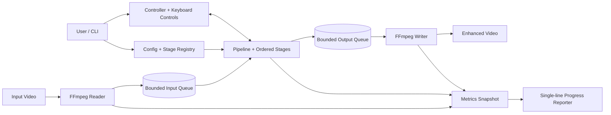

# vidpipe architecture

## 1. Purpose and scope

vidpipe decodes a video into RGB24 frames, applies an ordered chain of image-processing stages, and encodes the resulting frames. Frames are streamed through bounded queues in memory; the application does not write an intermediate image for every frame.

This release improves the existing PyTorch pipeline. It does **not** add ONNX, TensorRT, RIFE, multi-GPU execution or concurrent model-inference workers.

## 2. Directory structure

```text
vidpipe/
├── README.md                  # Installation, commands, configuration and usage
├── ARCHITECTURE.md            # This document: modules, data flow and design limits
├── config.yaml                # Default FFmpeg, device, memory and stage settings
├── requirements.txt           # Existing Python runtime/test requirements
├── .gitignore                  # Ignore models, media, outputs, caches and environments
├── bin/
│   └── vidpipe                 # Executable CLI launcher; avoids `python -m` at the prompt
├── scripts/
│   └── install-cli.sh          # Creates ~/.local/bin/vidpipe as a symlink to bin/vidpipe
├── models/                     # User-provided model weights; not committed to Git
├── output/                     # Default generated video output directory
├── vidpipe/
│   ├── __init__.py             # Package version
│   ├── main.py                 # Argument parsing, setup, CLI controls and application lifecycle
│   ├── config.py               # YAML defaults and validation of user settings
│   ├── controller.py           # Run-state transitions: pause, resume, stop and failure
│   ├── pipeline.py             # Reader/inference/writer threads, queues and timing counters
│   ├── video_io.py             # FFprobe metadata, FFmpeg frame decoding and video encoding
│   ├── memory.py               # Device selection, RAM queue sizing and PyTorch VRAM telemetry
│   ├── naming.py                # Model-chain, scale and denoise output-name generation
│   ├── progress.py              # Single-line, color-aware progress display and ETA
│   ├── controls.py              # Immediate P/R/S/Q keyboard controls; restores terminal mode
│   ├── registry.py              # Mapping from YAML stage names to stage classes
│   └── stages/
│       ├── __init__.py          # Stage package marker
│       ├── base.py              # Frame, FrameSpec and Stage interface
│       ├── identity.py          # Pass-through stage used by tests
│       └── model.py             # Spandrel model loading, tile batching and CUDA OOM recovery
└── tests/
    ├── test_config.py           # YAML validation tests
    ├── test_controller.py       # Controller state validation tests
    ├── test_memory.py           # Queue-depth and device/memory planning tests
    ├── test_pipeline.py         # Reader-to-writer pipeline and counters
    ├── test_naming.py           # Output filename and collision behavior
    ├── test_progress.py         # Progress formatting and ETA helper tests
    ├── test_model.py            # Tile batching and simulated CUDA OOM recovery
    └── test_video_io.py         # FFprobe frame-rate and frame-count estimation tests
```

## 3. Conceptual architecture

The application has three cooperating work areas: media I/O, ordered frame inference, and user control/telemetry. The bounded queues decouple the speeds of the reader, model and writer without allowing memory use to grow with video duration.



## 4. High-level data flow

```text
                         INPUT VIDEO
                              │
                              ▼
                     FFprobe / FFmpeg Reader
                              │
                              ▼
                    Bounded decoded-frame queue
                              │
                              ▼
                     Pipeline / Stage chain
                              │
                  ┌───────────┴───────────┐
                  │                     │
                  ▼                     ▼
             Stage 1: Model       Stage 2: Model ...
                  │                     │
                  └───────────┬─────────┘
                              ▼
                    Bounded output-frame queue
                              │
                              ▼
                      FFmpeg VideoWriter
                              │
                              ▼
                         OUTPUT VIDEO
```

The reader thread can decode upcoming frames while the pipeline thread processes the current frame. The writer thread can encode completed frames while the next frame is being enhanced. The queues are bounded, so memory use is not proportional to the full video duration.

## 5. Threads and queues

| Worker | Responsibility | Main wait point |
|---|---|---|
| Reader | Read fixed-size RGB24 frames from FFmpeg stdout | Input decoder / decoded-frame queue |
| Pipeline | Execute each configured stage in order | Model inference / output-frame queue |
| Writer | Send output frames to FFmpeg stdin | Encoder and disk I/O |

`queue_depth` is the maximum number of items in each queue. In automatic mode, `memory.py` estimates a RAM-safe depth from free RAM and decoded/output frame sizes. The actual depth is `min(config.queue_depth, memory_plan.depth)`. In manual mode, `memory.prefetch_depth` is used before applying the configured hard cap; a non-zero `memory.max_ram_gb` adds a second cap based on the combined input/output frame memory. The automatic estimate never forces more than one frame into each queue when RAM is tight.

The queue threads overlap CPU-side decode and encode with inference. They do not make the model stage itself multi-threaded and they do not execute multiple model calls concurrently on the GPU.

## 6. Model execution and tile batching

`ModelStage` loads each model once through Spandrel. It converts a frame to a `(1, 3, H, W)` tensor, pads the full frame so tiles can see real neighboring pixels, and then groups tiles by their crop dimensions.

Tiles with equal dimensions are combined along the batch dimension and sent to the model in one call. Border tiles can be narrower or shorter, so a different shape is processed in a separate batch. Each tile's center region is copied back into its correct output coordinates; padding pixels are not written into the final frame.

The optional PyTorch VRAM allocator cap is applied before model weights are loaded. It limits allocations made through PyTorch's CUDA caching allocator; it is not a hardware-wide reservation and does not constrain unrelated GPU processes.

The configured `batch_size` is the initial number of tiles per inference call. The actual final batch may be smaller when fewer tiles remain in a group.

### CUDA out-of-memory recovery

When a CUDA out-of-memory exception occurs during tiled inference:

1. If the batch contains more than one tile, halve the batch and retry the entire current frame.
2. If the batch is one, halve tile size down to 64 pixels and retry the entire current frame.
3. If batch size one and 64-pixel tiles still fail, raise a clear error.

The current frame is retried from the beginning after a failed attempt, so partially written tile results are not mixed into the final frame. The reduced batch/tile values are retained for subsequent frames in the same run. Recovery is best-effort: if the model weights or one minimum-size tile cannot fit in VRAM, the run still cannot proceed.

## 7. CPU/GPU transfers and synchronization

Each input frame is converted to a tensor and moved to the selected device. Tiled inference then stays on that device. At the end of a frame, the completed output is converted to uint8 and copied back to CPU memory once so it can be passed to FFmpeg.

The previous line-oriented input approach (`for line in sys.stdin`) required Enter after each control letter. `controls.py` now reads one character at a time in terminal cbreak mode; on POSIX it opens `/dev/tty` if stdin is redirected. The old terminal settings are restored when the listener exits.

There is no explicit `torch.cuda.synchronize()` in the tile loop. PyTorch queues CUDA work asynchronously; converting the final result to a CPU NumPy byte buffer is the required synchronization/transfer point for the completed frame. This design avoids an intentional full synchronization after every tile. It does not eliminate the one frame-level device-to-host transfer required by the current FFmpeg pipe interface.

## 8. Progress and performance metrics

`pipeline.py` keeps thread-safe counters (frames read/written, time in the reader, stage chain and writer, queue occupancy). `main.py` takes a snapshot of them at every refresh and passes it, with the run state and GPU telemetry, to `ProgressReporter`.

Before processing starts, `ProgressReporter.print_header` prints the static run information once: input, output, resolution, frame count, models, device, precision, codec and queue depth. These values never change during a run, so they are not repeated.

The live output is a **fixed six-line panel**:

1. Status, progress bar, exact done percentage and exact left percentage.
2. Frames processed / total, and remaining frames.
3. Smoothed FPS, wall-clock elapsed time and ETA.
4. Model name, tile progress (tile size and batch) and input/output queue occupancy.
5. VRAM usage (PyTorch), GPU utilization (NVML), and OOM retry count when non-zero.
6. Average decode, process and encode milliseconds per frame.

Design rules:

- **One source of truth for percentages.** Done and left percentages are both computed from `processed / total`, so they always sum to 100.
- **Fixed positions.** Each field has a fixed label width and value width, and padding is applied before ANSI colors, so columns stay aligned.
- **In-place redraw on a TTY.** `print_update` moves the cursor up by the number of lines drawn last time (`ESC[nA`), then rewrites each line after clearing it (`ESC[2K`). Redirected output gets one record per refresh instead.
- **Honest estimates.** When the frame count is estimated (variable frame rate), values are marked with `~` and `(approx.)`. ETA is based on smoothed throughput and is not a guarantee.
- **No forced synchronization.** The reporter reads counters and telemetry only. It never calls `torch.cuda.synchronize()`.

GPU telemetry is split between two sources. VRAM (allocated, reserved, free) comes from PyTorch. GPU utilization comes from NVML through the optional `pynvml` package, read by `memory.gpu_memory_stats`. If `pynvml` is missing or fails, the field shows `n/a` and processing continues. The NVML device index is fixed at 0, so it does not follow `CUDA_VISIBLE_DEVICES`.

## 9. Output naming and FFmpeg options

When `--output` is not supplied, `naming.py` builds a unique filename from:

1. input video stem;
2. model names in stage order;
3. final image scale measured from source/output dimensions (`no-upscale` for 1x);
4. `denoised` when a model filename contains a recognized marker such as `wdn` or `denoise`.

A numeric suffix is added if the generated name already exists. An explicit `--output` path is not replaced unless `--overwrite` is provided.

FFmpeg detects input demuxers and decoders automatically by default. Optional `--input-format` and `--decoder` arguments force them. Output codec, CRF, preset, pixel format, audio codec and muxer are passed to FFmpeg. CRF can be disabled for encoders that use a different quality control, and repeatable `--video-option KEY=VALUE` arguments pass encoder-specific options.

The available formats depend on the local FFmpeg build. `--list-encoders`, `--list-decoders`, `--list-formats` and `--list-pixel-formats` show the local capabilities rather than relying on a fixed list in the application.

## 10. Module responsibilities and contracts

| Module | Contract |
|---|---|
| `main.py` | Parses CLI options, loads config/stages, starts the controller, reports progress and connects runtime controls. |
| `controls.py` | Reads P/R/S/Q immediately without Enter, supports `/dev/tty` when stdin is redirected, and restores terminal settings. |
| `config.py` | Fills defaults, resolves relative model paths from the YAML file location, and validates settings/stages before workers start. |
| `controller.py` | Owns the run state and coordinates pause/resume/stop without force-killing worker threads. |
| `pipeline.py` | Owns the bounded queues, three workers, frame counters, timings and error propagation. |
| `video_io.py` | Converts source video to fixed-size RGB24 frames and sends output frames to FFmpeg. |
| `memory.py` | Selects CPU/CUDA, sets an optional PyTorch VRAM limit before model loading, calculates safe RAM queue depth, and reports VRAM (PyTorch) and GPU utilization (NVML, optional). |
| `naming.py` | Generates descriptive and collision-safe output paths. |
| `progress.py` | Builds the static header and the fixed six-line live panel, and redraws it in place on a TTY (cursor-up plus clear-line) or writes one record per update to a log. |
| `registry.py` | Selects CPU/CUDA, sets an optional PyTorch VRAM limit before model loading, calculates safe RAM queue depth, and reports VRAM (PyTorch) and GPU utilization (NVML, optional). |
| `stages/base.py` | Defines the `Frame`, `FrameSpec` and `Stage` contract. |
| `stages/identity.py` | Returns frames unchanged for pipeline tests. |
| `stages/model.py` | Loads image models, performs batched tiling, and retries smaller work units after CUDA OOM. |

## 10. Run states

```text
IDLE -> RUNNING -> FINISHED
           │  ├-> PAUSED -> RUNNING
           │  └-> STOPPING -> STOPPED
           └-> FAILED
```

Pause stops reading new input frames; it does not terminate a CUDA operation already running. Stop is cooperative: the current stage operation is allowed to return, queued work is drained as the pipeline shuts down, and FFmpeg's writer input is closed so the partial output can be finalized. A hard process kill can still leave an incomplete file.

## 11. Known limits in this phase

- One pipeline inference thread processes frames sequentially. Tile batching reduces per-call overhead but does not run multiple frames concurrently on the GPU.
- CUDA OOM recovery handles tile batch and tile size reductions; it cannot make an oversized model fit on a smaller GPU.
- The frame-count fallback is estimated for files without `nb_frames`; the progress display marks it as approximate.
- The output writer currently copies audio or disables it. Subtitle and chapter stream preservation are not implemented.
- TensorRT/ONNX engines, RIFE interpolation, multi-GPU scheduling and NVML GPU-utilization reporting are out of scope for this phase.
