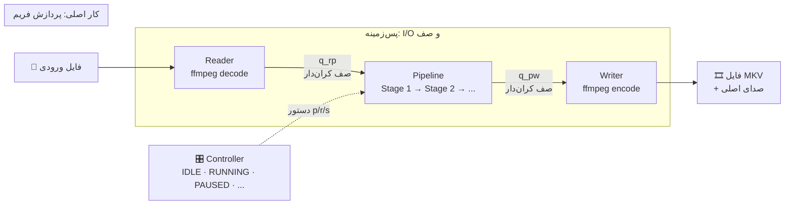
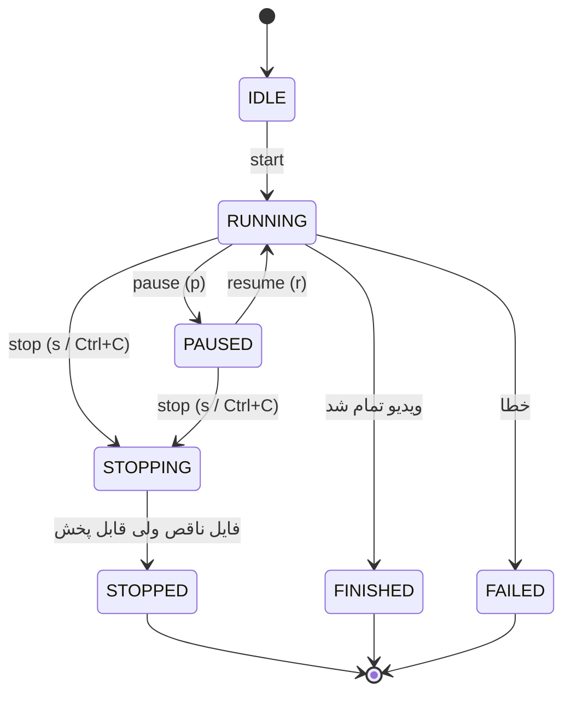
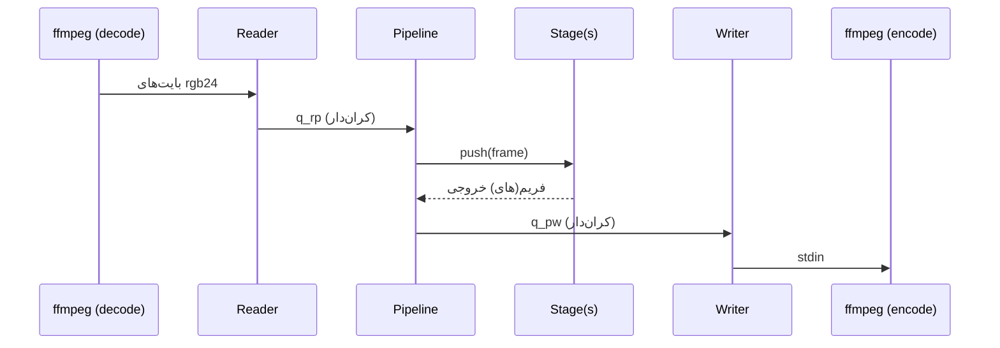

# معماری vidpipe

## ۱. ایده‌ی کلی

ویدیو فریم‌به‌فریم خوانده می‌شود، از زنجیرهٔ مراحل (مثلاً مدل‌های بهبود کیفیت) عبور داده می‌شود و دوباره به یک فایل MKV نوشته می‌شود.

- هیچ فریمی روی دیسک نوشته نمی‌شود.
- هیچ فایل موقتی ساخته نمی‌شود.
- صدا مستقیم از فایل اصلی کپی می‌شود.

## ۲. نمودار مفهومی

## ۳. سه رشته و دو صف

| رشته | کار |
|---|---|
| **reader** | فریم خام `rgb24` را از ffmpeg می‌خواند |
| **pipeline** | هر فریم را از مراحل به ترتیب عبور می‌دهد |
| **writer** | فریم‌های آماده را به encoder ffmpeg می‌دهد |

صف‌ها **کران‌دار** هستند. وقتی صفی پر شود، رشتهٔ قبلی منتظر می‌ماند. به همین دلیل مصرف حافظه به طول ویدیو وابسته نیست.

## ۴. حالت‌های اجرا

- **مکث (pause):** reader دیگر فریم نمی‌خواند. هیچ پردازشی kill نمی‌شود و حافظه ثابت می‌ماند.
- **توقف (stop):** reader متوقف می‌شود، بافر مراحل خالی می‌شود و ffmpeg با بستن stdin تمام می‌شود.

## ۵-الف. مسیر یک فریم

هر مرحله یک کلاس است با این متدها:

| متد | کار |
|---|---|
| `load` | یک‌بار در شروع، منابع (مثل مدل) را بارگذاری می‌کند |
| `plan` | اندازهٔ خروجی را از روی ورودی حساب می‌کند |
| `push` | یک فریم می‌گیرد و صفر یا چند فریم برمی‌گرداند |
| `flush` | در پایان، فریم‌های بافرشده را بیرون می‌دهد |
| `release` | منابع را آزاد می‌کند |

ترتیب مراحل در `config.yaml` تعیین می‌شود. مرحلهٔ `model` یک مدل `.pth` را با تایلینگ اجرا می‌کند؛ کاشی‌ها با پیکسل‌های همسایه کار می‌کنند تا درز دیده نشود.

## ۶. دستگاه و حافظه

- `device: auto` اگر CUDA باشد از GPU استفاده می‌کند، وگرنه CPU با هشدار.
- اندازهٔ صف‌ها از `queue_depth` در config خوانده می‌شود.
- `memory.py` فعلاً فقط مقادیر پیشنهادی را لاگ می‌کند و هنوز به صف‌ها وصل نشده است.

## ۷. فایل‌ها

| فایل | مسئولیت |
|---|---|
| `main.py` | ورودی خط فرمان، دستورهای کنترلی |
| `config.py` | خواندن و اعتبارسنجی YAML |
| `controller.py` | ماشین حالت و کنترل اجرا |
| `pipeline.py` | سه رشته و دو صف |
| `video_io.py` | ورودی و خروجی ffmpeg |
| `memory.py` | انتخاب دستگاه و برنامهٔ حافظه |
| `registry.py` | نام مرحله ← کلاس مرحله |
| `stages/base.py` | رابط پایهٔ مرحله |
| `stages/identity.py` | مرحلهٔ عبور مستقیم (برای تست) |
| `stages/model.py` | مرحلهٔ مدل با تایلینگ |

## ۸. اصول

1. **Stop و Pause امن:** هیچ پردازشی kill نمی‌شود.
2. **فایل همیشه قابل پخش:** MKV حتی بعد از توقف معتبر می‌ماند.
3. **حافظهٔ ثابت:** صف‌های کران‌دار، مستقل از طول ویدیو.
4. **سادگی:** هر فایل یک مسئولیت دارد و افزودن مدل جدید فقط شامل یک کلاس یا یک بلوک config است.