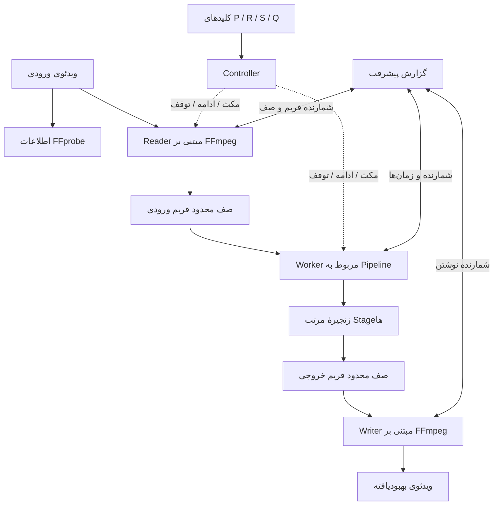
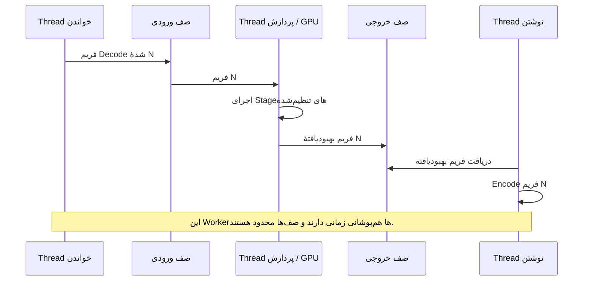
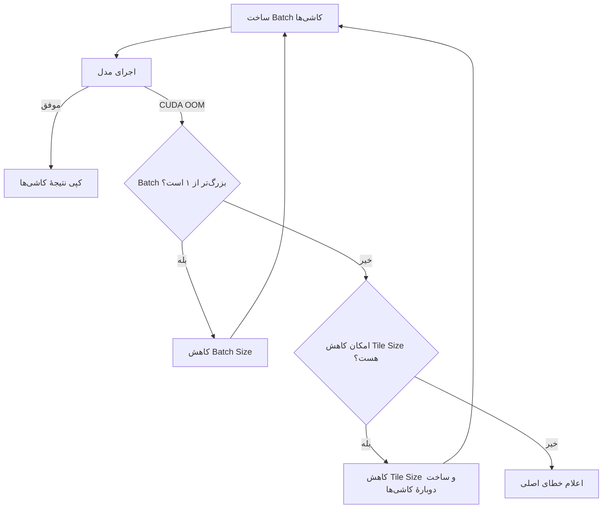

# معماری vidpipe

## ۱. هدف و محدوده

`vidpipe` ویدئو را به فریم‌های RGB24 تبدیل می‌کند، زنجیره‌ای مرتب از مراحل پردازش تصویر را روی فریم‌ها اجرا می‌کند و نتیجه را دوباره به ویدئو تبدیل می‌کند. فریم‌ها از طریق صف‌های محدود در حافظهٔ RAM منتقل می‌شوند؛ برای هر فریم فایل موقت جداگانه‌ای روی دیسک ساخته نمی‌شود.

این نسخه Pipeline مبتنی بر PyTorch و کنترل‌های CLI را بهبود می‌دهد. قابلیت‌های ONNX، TensorRT، RIFE، اجرای چند GPU و چند Worker هم‌زمان برای اجرای مدل در این نسخه پیاده‌سازی نشده‌اند.

## ۲. ساختار مخزن

```text
vidpipe/
├── README.md                    # راهنمای انگلیسی نصب، دستورات و استفاده
├── README_FA.md                 # ترجمهٔ فارسی راهنمای کاربر
├── ARCHITECTURE.md              # مستند معماری و جزئیات پیاده‌سازی به انگلیسی
├── ARCHITECTURE_FA.md           # ترجمهٔ فارسی همین مستند
├── config.yaml                  # مراحل پیش‌فرض، دستگاه، حافظه و تنظیمات FFmpeg
├── requirements.txt             # وابستگی‌های فعلی Python و تست‌ها
├── .gitignore                    # حذف مدل‌ها، رسانه‌ها، خروجی‌ها، Cache و محیط مجازی از Git
├── bin/
│   └── vidpipe                   # اجراکنندهٔ فرمان مستقیم vidpipe
├── scripts/
│   └── install-cli.sh            # ساخت Symlink در ~/.local/bin
├── models/                       # وزن مدل‌های کاربر؛ در Git ذخیره نمی‌شوند
├── output/                       # پوشهٔ پیش‌فرض ویدئوهای خروجی
├── vidpipe/
│   ├── __init__.py               # نسخهٔ Package
│   ├── main.py                   # آرگومان‌های CLI، آماده‌سازی برنامه و خاتمه
│   ├── controls.py               # دریافت فوری کلیدهای P/R/S/Q و بازگردانی تنظیمات ترمینال
│   ├── progress.py               # گزارش تک‌خطی، رنگ‌ها، FPS و ETA
│   ├── config.py                 # بارگذاری YAML، مقادیر پیش‌فرض و اعتبارسنجی
│   ├── controller.py             # وضعیت‌های اجرا و چرخهٔ عمر Pipeline
│   ├── pipeline.py               # Threadهای خواندن، پردازش و نوشتن؛ صف‌ها و شمارنده‌ها
│   ├── video_io.py               # اطلاعات FFprobe و Decode/Encode فریم با FFmpeg
│   ├── memory.py                 # انتخاب دستگاه، برنامه‌ریزی صف RAM و آمار VRAM
│   ├── naming.py                 # نام خروجی بر اساس مدل‌ها، Scale و Denoise
│   ├── registry.py               # اتصال نام Stage در YAML به کلاس Python
│   └── stages/
│       ├── __init__.py           # نشانگر Package مراحل
│       ├── base.py               # رابط Frame، FrameSpec و Stage
│       ├── identity.py           # مرحلهٔ عبور بدون تغییر؛ برای تست و Pipeline ساده
│       └── model.py              # بارگذاری مدل Spandrel، Tile Batching و بازیابی CUDA OOM
└── tests/
    ├── test_config.py            # خواندن و اعتبارسنجی تنظیمات
    ├── test_controller.py        # رفتار تغییر وضعیت Controller
    ├── test_controls.py          # دریافت کلید بدون Enter (تست PTY در POSIX)
    ├── test_memory.py            # انتخاب دستگاه، VRAM و برنامه‌ریزی عمق صف
    ├── test_model.py             # Tile Batching و بازیابی شبیه‌سازی‌شدهٔ CUDA OOM
    ├── test_naming.py            # نام خروجی و برخورد نام فایل‌ها
    ├── test_pipeline.py          # جریان Reader تا Writer، صف‌ها و شمارنده‌ها
    ├── test_progress.py          # متن گزارش، معیارها و بازنویسی همان خط
    └── test_video_io.py          # Metadata و تخمین تعداد فریم با FFprobe
```

## ۳. معماری مفهومی

برنامه سه Worker اصلی دارد. Reader فریم‌های بعدی را Decode می‌کند، Worker مربوط به Pipeline مراحل پردازش را به‌ترتیب اجرا می‌کند و Writer فریم‌های آماده را Encode می‌کند. صف‌های محدود بین این Workerها قرار دارند تا مصرف حافظه متناسب با مدت کل ویدئو رشد نکند.



### توالی کار Workerها



این نمودار هم‌زمانی Decode، پردازش و Encode را نشان می‌دهد؛ به این معنا نیست که چند فراخوانی مدل به‌طور هم‌زمان روی GPU اجرا می‌شوند.

## ۴. مسئولیت ماژول‌ها

| ماژول | مسئولیت |
|---|---|
| `main.py` | خواندن گزینه‌های خط فرمان، بارگذاری تنظیمات و Stageها، آماده‌سازی FFmpeg، اجرای Controller، نمایش پیشرفت و مدیریت خاتمه |
| `controls.py` | دریافت کلیدهای P/R/S/Q بدون انتظار برای Enter؛ استفاده از APIهای ترمینال POSIX در Linux/macOS و `msvcrt` در Windows؛ بازگردانی تنظیمات ترمینال |
| `progress.py` | ساخت پنل دوخطی پیشرفت، هموارسازی FPS، تخمین ETA، نمایش زمان و VRAM و بازنویسی پنل در همان محل ترمینال |
| `controller.py` | مدیریت وضعیت اجرا و Eventهای مکث/توقف؛ شروع و Join کردن Pipeline |
| `pipeline.py` | مدیریت Workerهای خواندن، پردازش و نوشتن، صف‌های محدود، شمارندهٔ فریم و مجموع زمان‌ها |
| `video_io.py` | دریافت Metadata با FFprobe و Decode/Encode فریم خام با پردازش‌های FFmpeg |
| `memory.py` | انتخاب CPU/CUDA، اعمال محدودیت اختیاری VRAM، تخمین عمق امن صف و گزارش حافظهٔ CUDA در PyTorch |
| `config.py` | بارگذاری YAML، تکمیل مقادیر پیش‌فرض و اعتبارسنجی تنظیمات مدل و FFmpeg |
| `naming.py` | ساخت نام خروجی از نام ورودی، ترتیب مدل‌ها، Scale ترکیبی و نشانگر Denoise |
| `registry.py` | تبدیل نام Stage مانند `model` به کلاس پیاده‌سازی آن |
| `stages/base.py` | تعریف ساختار مشترک فریم و رابط Stage |
| `stages/model.py` | بارگذاری مدل از طریق Spandrel و اجرای Tile Inference با Padding و Batch؛ در CUDA OOM ابتدا Batch و سپس Tile را کوچک می‌کند |
| `stages/identity.py` | عبور دادن فریم بدون تغییر؛ برای تست و تنظیمات بدون افزایش کیفیت |

## ۵. رفتار Threadها و صف‌ها

| Worker | مسئولیت اصلی | محل انتظار معمول |
|---|---|---|
| Reader | خواندن فریم‌های RGB24 از خروجی FFmpeg | Decoder یا پر شدن صف ورودی |
| Pipeline | اجرای Stageهای تنظیم‌شده به‌ترتیب | Inference روی GPU یا پر شدن صف خروجی |
| Writer | ارسال فریم‌ها به ورودی FFmpeg | Encoder یا عملیات دیسک |

`queue_depth` حداکثر تعداد فریم در هر صف است. عمق واقعی صف با مقدار تنظیم‌شده و برنامهٔ حافظهٔ RAM محدود می‌شود. عمق صف برای Prefetch فریم‌ها است و با Tile Batch Size در داخل مرحلهٔ مدل تفاوت دارد.

Pause مانع شروع کار جدید توسط Reader و Worker پردازش می‌شود. فریمی که در حال پردازش است ممکن است قبل از اثر کامل مکث به پایان برسد. Resume دوباره Event مشترک را فعال می‌کند. Stop از Workerها می‌خواهد در اولین مرز امن کار را تمام کنند، علامت پایان را در صف‌ها قرار دهند و FFmpeg را به‌شکل صحیح ببندند.

## ۶. ورودی کیبورد و رفتار ترمینال

روش قبلی `for line in sys.stdin` برای دریافت هر کلید به Enter نیاز داشت. اکنون `controls.py` در ترمینال تعاملی POSIX حالت cbreak را فعال می‌کند و با `select` و `os.read` یک کاراکتر در هر نوبت می‌خواند. در Windows از `msvcrt` استفاده می‌شود. با پایان Listener، تنظیمات اولیهٔ ترمینال بازگردانده می‌شوند.

- `P`: مکث.
- `R`: ادامه.
- `S` یا `Q`: درخواست توقف کنترل‌شده.
- `Ctrl+C`: توسط Signal Handler در Thread اصلی دریافت و به درخواست توقف کنترل‌شده تبدیل می‌شود.

در POSIX اگر stdin به فایل یا Pipe هدایت شده باشد، برنامه تلاش می‌کند ترمینال کنترل‌کننده را از `/dev/tty` باز کند؛ بنابراین تا وقتی برنامه از یک ترمینال تعاملی اجرا شده باشد، کلیدها همچنان قابل استفاده‌اند. اگر هیچ ترمینال کنترل‌کننده‌ای در دسترس نباشد، کنترل تک‌کلیدی غیرفعال می‌شود. گزارش پیشرفت نیز stdout یا stderr متصل به ترمینال را انتخاب می‌کند.

## ۷. محاسبه و نمایش پیشرفت

`pipeline.py` شمارنده‌های امن برای نخ‌ها نگه می‌دارد (فریم‌های خوانده و نوشته‌شده، زمان Reader، زنجیرهٔ Stageها و Writer و وضعیت صف‌ها). `main.py` در هر به‌روزرسانی از این شمارنده‌ها Snapshot می‌گیرد و آن را همراه وضعیت اجرا و آمار GPU به `ProgressReporter` می‌دهد.

قبل از شروع پردازش، `ProgressReporter.print_header` اطلاعات ثابت اجرا را یک‌بار چاپ می‌کند: ورودی، خروجی، رزولوشن، تعداد فریم، مدل‌ها، دستگاه، دقت، کدک و عمق صف. این مقادیر در طول اجرا تغییر نمی‌کنند، پس تکرار نمی‌شوند.

خروجی زنده یک **پنل شش‌خطی ثابت** است:

1. وضعیت، نوار پیشرفت، درصد دقیق انجام‌شده و درصد دقیق باقی‌مانده.
2. فریم‌های پردازش‌شده از کل و تعداد فریم‌های باقی‌مانده.
3. FPS هموارشده، زمان دیواری سپری‌شده و ETA.
4. نام مدل، پیشرفت کاشی‌ها (اندازه و Batch) و اشغال صف‌های ورودی و خروجی.
5. مصرف VRAM (از PyTorch)، درصد استفادهٔ GPU (از NVML) و شمارندهٔ بازیابی OOM در صورت غیرصفر بودن.
6. میانگین زمان Decode، Process و Encode برای هر فریم (میلی‌ثانیه).

قواعد طراحی:

- **یک منبع برای درصدها.** درصد انجام‌شده و باقی‌مانده هر دو از `processed / total` محاسبه می‌شوند، پس همیشه جمعشان ۱۰۰ است.
- **موقعیت ثابت.** هر فیلد عرض برچسب و مقدار ثابت دارد و پدینگ قبل از رنگ‌دهی اعمال می‌شود، بنابراین ستون‌ها هم‌تراز می‌مانند.
- **بازنویسی در همان محل روی TTY.** `print_update` به تعداد خطوطی که دفعهٔ قبل چاپ شده بالا می‌رود (`ESC[nA`) و هر خط را پس از پاک‌کردن (`ESC[2K`) دوباره می‌نویسد. خروجی Redirect شده به‌جای آن برای هر به‌روزرسانی یک رکورد می‌گیرد.
- **تخمین صادقانه.** وقتی شمارش فریم تخمینی است، مقادیر با `~` و `(approx.)` مشخص می‌شوند. ETA بر پایه‌ی سرعت هموارشده است و تضمین نیست.
- **بدون همگام‌سازی اجباری.** گزارشگر فقط شمارنده و آمار را می‌خواند و هیچ‌وقت `torch.cuda.synchronize()` صدا نمی‌زند.

آمار GPU از دو منبع می‌آید. VRAM (تخصیص‌یافته، رزرو‌شده، آزاد) از PyTorch خوانده می‌شود. درصد استفادهٔ GPU از NVML و از طریق پکیج اختیاری `pynvml` خوانده می‌شود (`memory.gpu_memory_stats`). اگر `pynvml` نباشد یا خطا بدهد، فیلد `n/a` نشان داده می‌شود و پردازش ادامه پیدا می‌کند. ایندکس دستگاه NVML ثابت روی `0` است و از `CUDA_VISIBLE_DEVICES` پیروی نمی‌کند.

## ۸. اجرای مدل و Tile Batching

`ModelStage` هر مدل را یک‌بار از طریق Spandrel بارگذاری می‌کند. فریم به Tensor تبدیل و برای دسترسی به اطلاعات پیکسل‌های همسایه Padding می‌شود، سپس به Tileها تقسیم می‌شود. Tileهایی که ابعاد Crop یکسان دارند در یک گروه قرار می‌گیرند و به‌صورت Batch به مدل داده می‌شوند. ناحیهٔ مرکزی خروجی هر Tile در مختصات درست تصویر نهایی کپی می‌شود؛ پیکسل‌های Padding وارد خروجی نهایی نمی‌شوند.

Tileهای لبه ممکن است ابعاد متفاوتی داشته باشند و در نتیجه در Batchهای جداگانه اجرا شوند. Batch Size تنظیم‌شده یک هدف است، نه تضمین اینکه هر گروه دقیقاً همان تعداد Tile داشته باشد.

### بازیابی خطای CUDA Out of Memory



این روش اندازهٔ تخصیص حافظهٔ فراخوانی بعدی مدل را کاهش می‌دهد. موفقیت را تضمین نمی‌کند؛ ممکن است خود مدل، برنامه‌های دیگر GPU یا حافظهٔ موردنیاز خروجی فریم از ظرفیت دستگاه بیشتر باشد.

## ۹. نام‌گذاری خروجی

اگر `--output` داده نشده باشد، `naming.py` نام فایل را از نام پایهٔ ورودی، نام مدل‌ها به ترتیب اجرا، ضریب Scale ترکیبی و نشانگر Denoise (در صورت تشخیص از نام مدل) می‌سازد. اگر `--output` داده شود، دقیقاً همان مسیر استفاده می‌شود.

## ۱۰. محدودیت‌های فعلی

- موتور پیاده‌سازی‌شده برای مدل PyTorch + Spandrel است؛ ONNX Runtime و TensorRT وجود ندارند.
- Reader، پردازش و Writer هم‌پوشانی دارند، اما فقط یک Worker پردازش زنجیرهٔ Stageها را اجرا می‌کند. چند Worker مستقل برای Inference پیاده‌سازی نشده‌اند.
- Tile Batching می‌تواند بهره‌وری ارسال کار به GPU را افزایش دهد، اما VRAM بیشتری مصرف می‌کند.
- درصد GPU Utilization فعلاً اندازه‌گیری نمی‌شود؛ فقط مصرف VRAM از PyTorch گزارش می‌شود.
- ETA تخمینی است و با تغییر مدل، ابعاد فریم یا بار Encoder می‌تواند تغییر کند.
- کلیدهای کیبورد به ترمینال تعاملی متصل به stdin نیاز دارند.

## ۱۱. تست‌ها

از ریشهٔ مخزن اجرا کن:

```bash
python -m pytest -q
```

مجموعهٔ تست‌ها تنظیمات، وضعیت Controller، ورودی کیبورد، برنامه‌ریزی حافظه، Tile Inference و بازیابی OOM، نام خروجی، شمارنده‌های Pipeline، گزارش پیشرفت و اطلاعات FFmpeg را پوشش می‌دهد.
