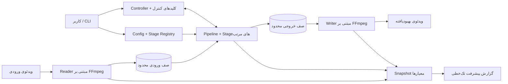
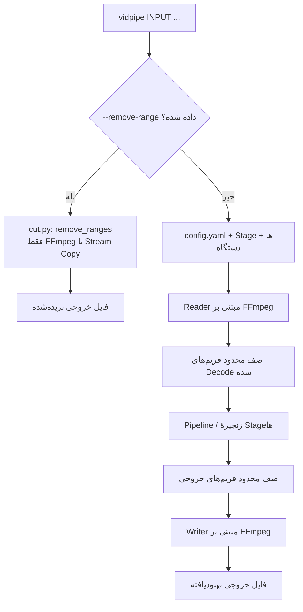
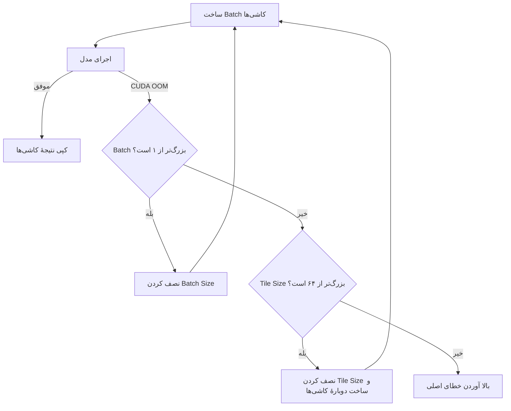
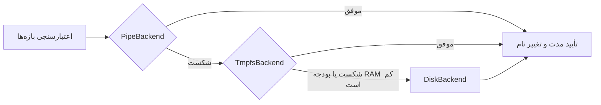
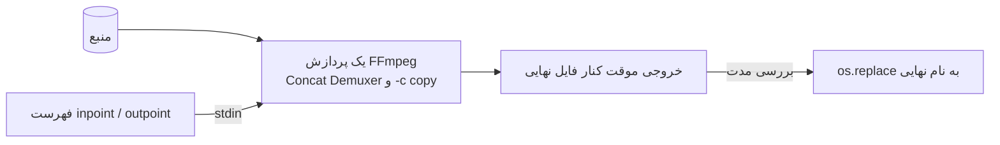
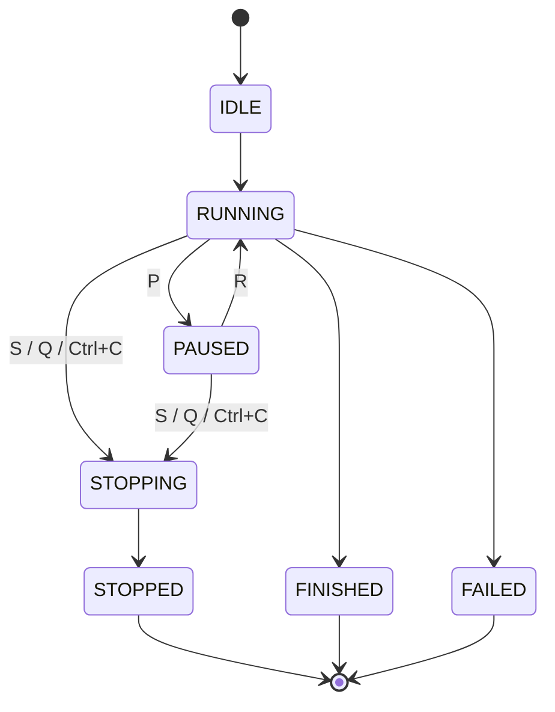

# معماری vidpipe

## ۱. هدف و محدوده

`vidpipe` دو کار مستقل انجام می‌دهد که با یک CLI اجرا می‌شوند:

۱. **بهبود کیفیت:** ویدئو را به فریم‌های RGB24 تبدیل می‌کند، فریم‌ها را از زنجیره‌ای مرتب از مراحل مدل عبور می‌دهد و نتیجه را Encode می‌کند. فریم‌ها از طریق صف‌های محدود در RAM منتقل می‌شوند و برای هر فریم تصویر میانی ساخته نمی‌شود.
۲. **حذف بازه‌های زمانی بدون افت کیفیت:** `--remove-range` بازه‌ها را با Stream Copy در FFmpeg (`-c copy`) حذف می‌کند. هیچ چیزی Re-encode نمی‌شود و هیچ مدلی لود نمی‌شود.

این نسخه Pipeline مبتنی بر PyTorch را بهبود می‌دهد. قابلیت‌های ONNX، TensorRT، RIFE، اجرای چند GPU و چند Worker هم‌زمان برای اجرای مدل در این نسخه پیاده‌سازی نشده‌اند.

## ۲. ساختار مخزن

```
vidpipe/
├── README.md                    # راهنمای انگلیسی نصب، دستورات و استفاده
├── README_FA.md                 # ترجمهٔ فارسی راهنمای کاربر
├── ARCHITECTURE.md              # مستند معماری و جزئیات پیاده‌سازی به انگلیسی
├── ARCHITECTURE_FA.md           # ترجمهٔ فارسی همین مستند
├── config.yaml                  # مراحل پیش‌فرض، دستگاه، حافظه و تنظیمات FFmpeg
├── requirements.txt             # وابستگی‌های Python و تست‌ها
├── .gitignore                   # حذف مدل‌ها، رسانه‌ها، خروجی‌ها، Cache و محیط مجازی از Git
├── bin/
│   └── vidpipe                  # اجراکنندهٔ فرمان مستقیم vidpipe
├── scripts/
│   └── install-cli.sh           # ساخت Symlink در ~/.local/bin
├── models/                      # وزن مدل‌های کاربر؛ در Git ذخیره نمی‌شوند
├── output/                      # پوشهٔ پیش‌فرض ویدئوهای خروجی
├── vidpipe/
│   ├── __init__.py              # نسخهٔ Package
│   ├── main.py                  # آرگومان‌های CLI؛ انتخاب حالت حذف بازه یا بهبود کیفیت
│   ├── cut.py                   # حذف بازه‌ها بدون Re-encode با Backendهای pipe، tmpfs و disk
│   ├── config.py                # بارگذاری YAML، مقادیر پیش‌فرض و اعتبارسنجی
│   ├── controller.py            # وضعیت‌های اجرا و چرخهٔ عمر Pipeline
│   ├── pipeline.py              # Threadهای خواندن، پردازش و نوشتن؛ صف‌ها و شمارنده‌ها
│   ├── video_io.py              # اطلاعات FFprobe و Decode/Encode فریم با FFmpeg
│   ├── memory.py                # انتخاب دستگاه، برنامه‌ریزی صف RAM و آمار VRAM
│   ├── naming.py                # نام خروجی بر اساس مدل‌ها، Scale و Denoise
│   ├── progress.py              # گزارش تک‌خطی، رنگ‌ها، FPS و ETA
│   ├── controls.py              # دریافت فوری کلیدهای P/R/S/Q و بازگردانی تنظیمات ترمینال
│   ├── registry.py              # اتصال نام Stage در YAML به کلاس Python
│   └── stages/
│       ├── __init__.py          # نشانگر Package مراحل
│       ├── base.py              # رابط Frame، FrameSpec و Stage
│       ├── identity.py          # مرحلهٔ عبور بدون تغییر؛ برای تست
│       └── model.py             # بارگذاری مدل Spandrel، Tile Batching و بازیابی CUDA OOM
└── tests/
    ├── test_config.py           # خواندن و اعتبارسنجی تنظیمات
    ├── test_controller.py       # رفتار تغییر وضعیت Controller
    ├── test_controls.py         # دریافت کلید بدون Enter (تست PTY در POSIX)
    ├── test_cut.py              # حذف بازه‌ها: هر Backend، Fallback و پاک‌سازی
    ├── test_memory.py           # انتخاب دستگاه، VRAM و برنامه‌ریزی عمق صف
    ├── test_model.py            # Tile Batching و بازیابی شبیه‌سازی‌شدهٔ CUDA OOM
    ├── test_naming.py           # نام خروجی و برخورد نام فایل‌ها
    ├── test_pipeline.py         # جریان Reader تا Writer، صف‌ها و شمارنده‌ها
    ├── test_progress.py         # متن گزارش، معیارها و بازنویسی همان خط
    └── test_video_io.py         # Metadata و تخمین تعداد فریم با FFprobe
```

## ۳. معماری مفهومی

مسیر بهبود کیفیت سه بخش همکار دارد: ورودی/خروجی رسانه، استنتاج مرتب فریم‌ها، و کنترل کاربر با تله‌متری. صف‌های محدود سرعت Reader، مدل و Writer را از هم جدا می‌کنند، بدون اینکه مصرف حافظه به مدت ویدئو وابسته شود.



## ۴. جریان کلی داده

`main.py` پیش از لود شدن هر چیز دیگر، یکی از دو مسیر را انتخاب می‌کند:



Reader می‌تواند فریم‌های بعدی را Decode کند، در حالی که Thread پردازش فریم جاری را انجام می‌دهد. Writer هم می‌تواند فریم‌های آماده را Encode کند، در حالی که فریم بعدی بهبود پیدا می‌کند. صف‌ها محدود هستند، پس مصرف حافظه با طول کل ویدئو متناسب نیست.

## ۵. Threadها و صف‌ها

| Worker   | مسئولیت اصلی                          | محل انتظار معمول                     |
|----------|---------------------------------------|--------------------------------------|
| Reader   | خواندن فریم‌های RGB24 از خروجی FFmpeg | Decoder یا پر شدن صف ورودی           |
| Pipeline | اجرای Stageهای تنظیم‌شده به‌ترتیب     | Inference روی GPU یا پر شدن صف خروجی |
| Writer   | ارسال فریم‌ها به ورودی FFmpeg         | Encoder یا عملیات دیسک               |

`queue_depth` حداکثر تعداد آیتم در هر صف است. در حالت خودکار، `memory.py` عمق امن را بر اساس RAM آزاد و اندازهٔ فریم‌های ورودی و خروجی تخمین می‌زند. عمق واقعی برابر `min(config.queue_depth, memory_plan.depth)` است. در حالت دستی، `memory.prefetch_depth` استفاده می‌شود و اگر `memory.max_ram_gb` مقدار داشته باشد، سقف دومی بر اساس حافظهٔ ورودی و خروجی اعمال می‌شود. عمق صف فقط برای Prefetch فریم‌هاست و با Tile Batch Size داخل مرحلهٔ مدل فرق دارد.

صف‌ها Decode و Encode را با استنتاج هم‌پوشان می‌کنند. آن‌ها مرحلهٔ مدل را چندنخی نمی‌کنند و چند فراخوانی مدل را هم‌زمان روی GPU اجرا نمی‌کنند.

حالت حذف بازه‌ها از این Threadها استفاده نمی‌کند. زیرپردازش‌های FFmpeg یکی پس از دیگری اجرا می‌شوند (بخش ۱۱).

## ۶. اجرای مدل، Tile Batching و بازیابی OOM

`ModelStage` هر مدل را یک‌بار از طریق Spandrel لود می‌کند. فریم را به Tensor با شکل `(1, 3, H, W)` تبدیل می‌کند، کل فریم را Padding می‌دهد تا کاشی‌ها پیکسل‌های همسایهٔ واقعی را ببینند، و کاشی‌ها را بر اساس ابعاد Crop گروه‌بندی می‌کند.

کاشی‌های هم‌اندازه در بُعد Batch کنار هم قرار می‌گیرند و در یک فراخوانی به مدل داده می‌شوند. کاشی‌های لبه ممکن است باریک‌تر یا کوتاه‌تر باشند، پس در Batch جداگانه اجرا می‌شوند. ناحیهٔ مرکزی خروجی هر کاشی به مختصات درست تصویر نهایی کپی می‌شود؛ پیکسل‌های Padding هرگز وارد فریم نهایی نمی‌شوند.

محدودیت اختیاری VRAM در PyTorch قبل از لود شدن وزن‌های مدل اعمال می‌شود. این محدودیت تخصیص‌های Allocator کش CUDA در PyTorch را محدود می‌کند. رزرو سخت‌افزاری کل GPU نیست و روی پردازش‌های دیگر GPU اثری ندارد.

`batch_size` تنظیم‌شده تعداد اولیهٔ کاشی‌ها در هر فراخوانی است. Batch واقعی ممکن است کوچک‌تر باشد، وقتی کاشی‌های کمتری در یک گروه مانده باشد.

### بازیابی خطای CUDA Out of Memory



فریمی که خطا داده از ابتدا دوباره اجرا می‌شود، پس نتیجهٔ نیمه‌کاره هرگز با فریم نهایی مخلوط نمی‌شود. مقدارهای کاهش‌یافتهٔ Batch و Tile برای فریم‌های بعدی همان اجرا نگه داشته می‌شوند. این بازیابی بهترین تلاش است: اگر وزن مدل یا یک کاشی با حداقل اندازه در VRAM جا نشود، اجرا ادامه پیدا نمی‌کند.

## ۷. انتقال CPU/GPU و همگام‌سازی

هر فریم ورودی به Tensor تبدیل و به دستگاه انتخاب‌شده منتقل می‌شود. استنتاج کاشی‌ها روی همان دستگاه می‌ماند. در پایان هر فریم، خروجی کامل به uint8 تبدیل و یک بار به حافظهٔ CPU کپی می‌شود تا به FFmpeg داده شود.

داخل حلقهٔ کاشی‌ها `torch.cuda.synchronize()` صریح وجود ندارد. PyTorch کار CUDA را به‌صورت ناهم‌زمان در صف می‌گذارد؛ تبدیل نتیجهٔ نهایی به بایت‌های CPU نقطهٔ همگام‌سازی فریم کامل است. این کار از همگام‌سازی کامل بعد از هر کاشی جلوگیری می‌کند. اما کپی Device به Host برای هر فریم را حذف نمی‌کند، چون FFmpeg از ورودی Pipe استفاده می‌کند.

## ۸. ورودی کیبورد و رفتار ترمینال

روش قبلی `for line in sys.stdin` برای دریافت هر کلید به Enter نیاز داشت. اکنون `controls.py` در ترمینال تعاملی POSIX حالت cbreak را فعال می‌کند و یک کاراکتر در هر نوبت می‌خواند. اگر stdin Redirect شده باشد، در لینوکس از `/dev/tty` استفاده می‌شود. در Windows از `msvcrt` استفاده می‌شود. با پایان Listener، تنظیمات اولیهٔ ترمینال بازگردانده می‌شوند.

- `P`: مکث. `R`: ادامه. `S` یا `Q`: درخواست توقف کنترل‌شده. `Ctrl+C`: Signal Handler در Thread اصلی آن را به همان درخواست توقف تبدیل می‌کند.
- اگر ترمینال کنترل‌کننده در دسترس نباشد، کنترل تک‌کلیدی غیرفعال می‌شود و پردازش ادامه پیدا می‌کند.

## ۹. گزارش پیشرفت و معیارهای عملکرد

`pipeline.py` شمارنده‌های امن برای Thread را نگه می‌دارد (فریم‌های خوانده و نوشته‌شده، زمان Reader، زنجیرهٔ Stageها و Writer، و وضعیت صف‌ها). `main.py` در هر به‌روزرسانی از آن‌ها Snapshot می‌گیرد و همراه وضعیت اجرا و آمار GPU به `ProgressReporter` می‌دهد.

قبل از شروع پردازش، `ProgressReporter.print_header` اطلاعات ثابت اجرا را یک بار چاپ می‌کند: ورودی، خروجی، رزولوشن، تعداد فریم، مدل‌ها، دستگاه، دقت، کدک و عمق صف.

خروجی زنده یک **پنل شش‌خطی ثابت** است:

۱. وضعیت، نوار پیشرفت، درصد دقیق انجام‌شده و درصد دقیق باقی‌مانده.
۲. فریم‌های پردازش‌شده از کل و تعداد فریم‌های باقی‌مانده.
۳. FPS هموارشده، زمان دیواری سپری‌شده و ETA.
۴. نام مدل، پیشرفت کاشی‌ها (اندازه و Batch) و اشغال صف‌های ورودی و خروجی.
۵. مصرف VRAM (از PyTorch)، درصد استفادهٔ GPU (از NVML) و شمارندهٔ بازیابی OOM در صورت غیرصفر بودن.
۶. میانگین زمان Decode، Process و Encode برای هر فریم (میلی‌ثانیه).

قواعد طراحی:

- **یک منبع برای درصدها.** درصد انجام‌شده و باقی‌مانده هر دو از `processed / total` محاسبه می‌شوند، پس همیشه جمعشان ۱۰۰ است.
- **موقعیت ثابت.** هر فیلد عرض برچسب و مقدار ثابت دارد و پدینگ قبل از رنگ‌دهی اعمال می‌شود، بنابراین ستون‌ها هم‌تراز می‌مانند.
- **بازنویسی در همان محل روی TTY.** `print_update` به تعداد خطوط دفعهٔ قبل بالا می‌رود (`ESC[nA`) و هر خط را پس از پاک‌کردن (`ESC[2K`) دوباره می‌نویسد. خروجی Redirect شده برای هر به‌روزرسانی یک رکورد می‌گیرد.
- **تخمین صادقانه.** وقتی شمارش فریم تخمینی است، مقادیر با `~` و `(approx.)` مشخص می‌شوند. ETA بر پایهٔ سرعت هموارشده است و تضمین نیست.
- **بدون همگام‌سازی اجباری.** گزارشگر فقط شمارنده و آمار را می‌خواند.

آمار GPU از دو منبع می‌آید. VRAM (تخصیص‌یافته، رزروشده، آزاد) از PyTorch خوانده می‌شود. درصد استفادهٔ GPU از NVML و از طریق پکیج اختیاری `pynvml` خوانده می‌شود (`memory.gpu_memory_stats`). اگر `pynvml` نباشد یا خطا بدهد، فیلد `n/a` نشان داده می‌شود. ایندکس دستگاه NVML ثابت روی `0` است و از `CUDA_VISIBLE_DEVICES` پیروی نمی‌کند.

## ۱۰. نام‌گذاری خروجی و گزینه‌های FFmpeg

در حالت بهبود کیفیت، اگر `--output` داده نشده باشد، `naming.py` نام یکتا را از این موارد می‌سازد:

۱. نام پایهٔ ویدئوی ورودی؛
۲. نام مدل‌ها به ترتیب اجرا؛
۳. Scale نهایی تصویر، از ابعاد ورودی و خروجی (`no-upscale` برای ۱x)؛
۴. `denoised` وقتی نام یک مدل نشانگری مثل `wdn` یا `denoise` داشته باشد.

اگر نام تکراری باشد، پسوند عددی اضافه می‌شود. مسیر صریح `--output` بدون `--overwrite` هرگز جایگزین نمی‌شود.

FFmpeg به‌صورت پیش‌فرض Demuxer و Decoder را خودکار تشخیص می‌دهد؛ `--input-format` و `--decoder` آن‌ها را اجباری می‌کنند. Codec خروجی، CRF، Preset، Pixel Format، کدک صدا و Muxer به FFmpeg داده می‌شوند. CRF برای انکودرهایی که کنترل کیفیت دیگری دارند قابل غیرفعال‌سازی است، و `--video-option KEY=VALUE` گزینه‌های مخصوص انکودر را تکرار می‌کند.

فرمت‌های موجود به نسخهٔ FFmpeg نصب‌شده بستگی دارند. `--list-encoders`، `--list-decoders`، `--list-formats` و `--list-pixel-formats` قابلیت‌های همان نسخه را نشان می‌دهند.

## ۱۱. حذف بازه‌های زمانی بدون افت کیفیت (`cut.py`)

### ورود و نام‌گذاری

`main()` قبل از `_run()` وجود `--remove-range` را بررسی می‌کند. در حالت حذف بازه، `config.yaml`، Stageهای مدل، انتخاب دستگاه و Pipeline بهبود کیفیت همگی کنار گذاشته می‌شوند. فقط `ffprobe` و `ffmpeg` اجرا می‌شوند.

- خروجی پیش‌فرض: `<نام ورودی>_cut<پسوند ورودی>` کنار فایل ورودی. `--output-dir` در این حالت استفاده نمی‌شود.
- `-o/--output` مسیر دقیق را تعیین می‌کند. اگر پسوند نداشته باشد، پسوند ورودی (یا `.mkv`) استفاده می‌شود.
- فایل خروجی موجود بدون `--overwrite` بازنویسی نمی‌شود.

### مدیریت بازه‌ها

هر بازه به شکل `START-END` است و هر طرف می‌تواند ثانیه (`90`)، `MM:SS` (`1:30`) یا `HH:MM:SS[.fraction]` (`00:01:30.5`) باشد. ماژول پیش از اجرای هر دستور FFmpeg این موارد را بررسی می‌کند:

- `END` باید بعد از `START` باشد و نباید از طول ویدئوی ffprobe بیشتر شود.
- بازه‌های هم‌پوشان یا متصل مرتب و ادغام می‌شوند.
- متمم بازه‌های حذفی، قطعات نگه‌داشته‌شده است. حذف کل ویدئو خطا است.

### Backendها

`remove_ranges` سه Backend را به‌ترتیب امتحان می‌کند. اولین روشی که موفق شود نتیجه را می‌دهد. هر `BackendUnavailable`، خطای FFmpeg، `OSError` یا شکست تأیید خروجی باعث می‌شود Backend بعدی اجرا شود.



| Backend | روش کار | فایل موقت | نوشتن روی دیسک |
|---|---|---|---|
| `PipeBackend` (اصلی) | یک پردازش FFmpeg منبع را یک بار می‌خواند. Concat Demuxer فهرستی از ورودی‌های `file:` همراه `inpoint`/`outpoint` را از stdin می‌گیرد. | ندارد (فهرست از stdin می‌آید) | فقط خروجی نهایی |
| `TmpfsBackend` (جایگزین) | هر بخش نگه‌داشته‌شده در `/dev/shm` نوشته و سپس چسبانده می‌شود. | بخش‌ها در RAM | فقط خروجی نهایی |
| `DiskBackend` (آخرین جایگزین) | هر بخش کنار خروجی روی دیسک نوشته و سپس چسبانده می‌شود. | بخش‌ها روی دیسک | بخش‌ها + خروجی |



`TmpfsBackend` نیاز خود را این‌طور تخمین می‌زند: `حجم منبع × نسبت نگه‌داشته‌شده × ۱.۱۵`. اگر این مقدار از نصف کوچک‌ترین مقدار بین فضای آزاد `/dev/shm` و `MemAvailable` بیشتر باشد، اجرا نمی‌شود. این عدد تخمین است، نه اندازه‌گیری.

### ایمنی

- خروجی با نام موقت در همان پوشهٔ خروجی نوشته می‌شود و فقط بعد از موفقیت به نام نهایی تغییر می‌کند. در شکست، فایل موقت پاک می‌شود.
- پوشه‌های موقت بخش‌ها (`.vidpipe-cut-*`) حتی بعد از خطا توسط `TemporaryDirectory` پاک می‌شوند.
- `_verify` مدت خروجی را با مجموع بخش‌های نگه‌داشته‌شده مقایسه می‌کند. تلورانس برابر `۲ ثانیه × تعداد بخش + ۵٪` است. این بررسی خروجی خالی یا ناقص را رد می‌کند.
- همهٔ Streamها (`-map 0`) نگه داشته می‌شوند؛ صدا، زیرنویس و داده با همان کدک کپی می‌شوند.

### دقت و هزینه

Stream Copy نمی‌تواند داخل یک GOP برش بزند، پس نقطهٔ برش به Keyframe منتقل می‌شود. نتیجه در یک تست ۶۰ ثانیه‌ای با GOP یک‌ثانیه‌ای و دو برش (۱۰ تا ۲۰ ثانیه و ۴۰ تا ۴۵ ثانیه):

| Backend | مدت خروجی | مورد انتظار |
|---|---|---|
| pipe | ۴۵.۰۵ ثانیه | حدود ۴۵.۰۲ |
| disk / tmpfs | ۴۷.۶۷ ثانیه | حدود ۴۵.۰۲ |

Backendهای مبتنی بر بخش‌ها هر بخش را از Keyframe قبل از نقطهٔ برش شروع می‌کنند، پس ممکن است برای هر بخش تا حدود یک GOP بیشتر شوند. Backend مبتنی بر pipe بیشتر این انحراف را حذف می‌کند.

نوشتن روی دیسک برای یک منبع ۲۰۱ مگابایتی، ۳ دقیقه‌ای و ۷۲۰p (برش ۳۰ تا ۶۰ ثانیه و ۱۰۰ تا ۱۲۰ ثانیه): pipe ۱۴۵ مگابایت، tmpfs ۱۴۸ مگابایت (بخش‌ها در RAM می‌مانند)، disk ۲۹۶ مگابایت (بخش‌ها به‌علاوهٔ خروجی).

### محدودیت‌های فعلی

- انتخاب Backend خودکار است. از Python می‌شود با `remove_ranges(..., backend="pipe"|"tmpfs"|"disk")` اجبارش کرد. هنوز پرچم CLI ندارد.
- نقاط برش روی Keyframe قرار می‌گیرند. برش دقیق فریم‌به‌فریم نیازمند Re-encode است و خارج از این حالت است.

## ۱۲. مسئولیت ماژول‌ها و قراردادها

| ماژول | قرارداد |
|---|---|
| `main.py` | گزینه‌های CLI را می‌خواند. با `--remove-range` به `remove_ranges` می‌رود؛ در غیر این صورت تنظیمات و Stageها را لود می‌کند، Controller را اجرا می‌کند، پیشرفت را نمایش می‌دهد و کنترل‌های زمان اجرا را وصل می‌کند. |
| `cut.py` | بازه‌ها را تجزیه و اعتبارسنجی می‌کند، بخش‌های نگه‌داشته‌شده را محاسبه می‌کند و با Backendهای pipe، tmpfs یا disk حذف را انجام می‌دهد؛ همراه با تأیید خروجی و پاک‌سازی. فقط از `ffprobe` و `ffmpeg` استفاده می‌کند. |
| `controls.py` | کلیدهای P/R/S/Q را بدون Enter می‌خواند، در صورت Redirect بودن stdin از `/dev/tty` استفاده می‌کند و تنظیمات ترمینال را بازمی‌گرداند. |
| `config.py` | مقادیر پیش‌فرض را پر می‌کند، مسیر نسبی مدل‌ها را نسبت به فایل YAML حل می‌کند و تنظیمات و Stageها را قبل از شروع Workerها اعتبارسنجی می‌کند. |
| `controller.py` | وضعیت اجرا را نگه می‌دارد و مکث، ادامه و توقف را بدون کشتن اجباری Threadها هماهنگ می‌کند. |
| `pipeline.py` | صف‌های محدود، سه Worker، شمارنده‌های فریم، زمان‌ها و انتشار خطا را مدیریت می‌کند. |
| `video_io.py` | ویدئوی ورودی را به فریم‌های RGB24 با اندازهٔ ثابت تبدیل می‌کند و فریم‌های خروجی را به FFmpeg می‌فرستد. |
| `memory.py` | CPU یا CUDA را انتخاب می‌کند، محدودیت اختیاری VRAM را قبل از لود مدل تنظیم می‌کند، عمق امن صف RAM را حساب می‌کند و VRAM (PyTorch) و استفادهٔ GPU (NVML، اختیاری) را گزارش می‌کند. |
| `naming.py` | نام‌های خروجی یکتا و توصیفی را برای حالت بهبود کیفیت می‌سازد. |
| `progress.py` | هدر ثابت و پنل زندهٔ شش‌خطی را می‌سازد. روی TTY در همان محل بازنویسی می‌کند و در لاگ برای هر به‌روزرسانی یک رکورد می‌نویسد. |
| `registry.py` | نام Stageهای YAML (`model`، `identity`) را به کلاس‌ها تبدیل می‌کند. نام ناشناخته خطا می‌دهد. |
| `stages/base.py` | قرارداد `Frame`، `FrameSpec` و `Stage` را تعریف می‌کند. |
| `stages/identity.py` | فریم‌ها را بدون تغییر برمی‌گرداند؛ برای تست Pipeline. |
| `stages/model.py` | مدل‌های تصویری را لود می‌کند، Tile Batching انجام می‌دهد و بعد از CUDA OOM واحدهای کاری کوچک‌تر را دوباره امتحان می‌کند. |

## ۱۳. وضعیت‌های اجرا



Pause خواندن ورودی‌های جدید را متوقف می‌کند؛ CUDA عملیاتی را که در حال اجراست قطع نمی‌کند. Stop کوآپراتیو است: عملیات Stage جاری اجازه دارد برگردد، کارهای صف تخلیه می‌شوند و ورودی FFmpeg بسته می‌شود تا خروجی جزئی نهایی شود. کشتن اجباری فرایند هنوز ممکن است فایل ناقص بگذارد.

حالت حذف بازه وضعیت اجرا ندارد. یا موفق برمی‌گردد یا خطا می‌دهد.

## ۱۴. محدودیت‌های شناخته‌شده در این مرحله

- یک Thread استنتاج، فریم‌ها را به‌ترتیب پردازش می‌کند. Tile Batching هزینهٔ هر فراخوانی را کم می‌کند، اما چند فریم را هم‌زمان روی GPU اجرا نمی‌کند.
- بازیابی CUDA OOM فقط Batch و Tile را کوچک می‌کند؛ مدلی که بزرگ‌تر از GPU باشد با این روش اجرا نمی‌شود.
- شمارش فریم برای فایل‌های بدون `nb_frames` تخمینی است و در گزارش با `~` مشخص می‌شود.
- در حالت بهبود کیفیت، صدا کپی یا حذف می‌شود. زیرنویس و فصل‌بندی پشتیبانی نمی‌شوند. حالت حذف بازه همهٔ Streamها را کپی می‌کند.
- TensorRT/ONNX، درون‌یابی RIFE و زمان‌بندی چند GPU خارج از محدوده هستند.
- نقاط برش روی Keyframe قرار می‌گیرند؛ Backendهای disk و tmpfs ممکن است برای هر بخش تا یک GOP بیشتر تولید کنند.